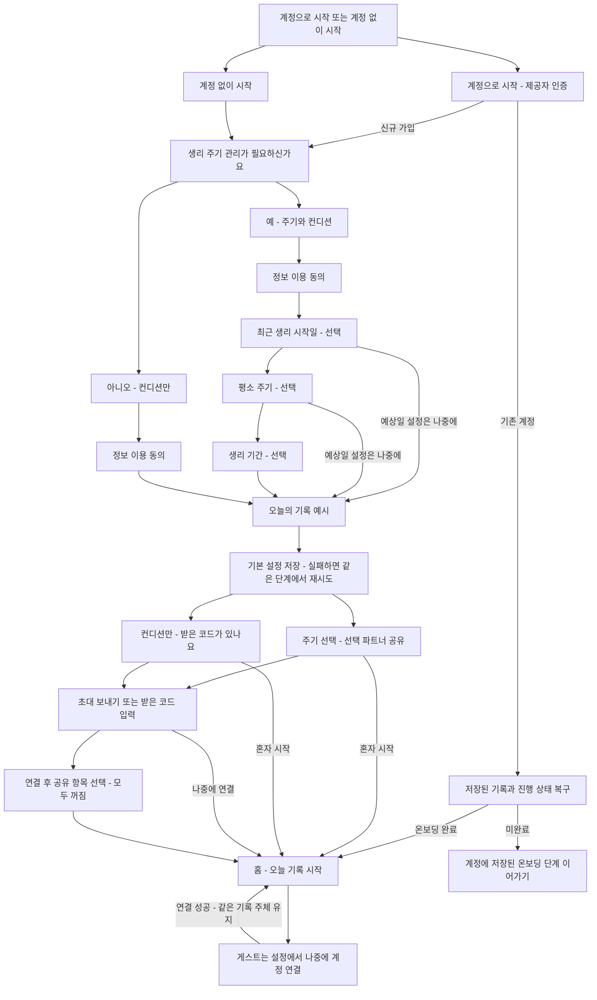

# 한 질문씩 시작하는 온보딩과 뒤로 이동

- 설계 ID: `2026-10-25-onboarding-navigation`, 버전 2
- 상태: 사람 검토 대기. 제품 구현은 시작하지 않았다.
- 기준 소스: `139e9a05c4ed0f90fe8f1a45593cee06202c59a6`
- 관련 작업: [Issue #152](https://github.com/seorilabs/cycle-pair/issues/152)
- 화면 원본: [조작 가능한 설계 미리보기](preview.html), 검수 계획: [test-plan.json](test-plan.json)
- 선행 작업: [마켓 신고와 이미지 등록 완료](../../launch/market-registration-20261025.md), PR #151 병합
- 2026-10-25 추가 요청: [계정으로 시작하고 나중에도 연결하는 흐름](account-design.md)을 첫 화면에 반영했다. 로그인 수단을 선택한 뒤 인증 테스트 계획을 통합한다. 기존 설계 승인 질문에 소셜 인증 설정과 네이티브 검증이 포함된 것으로 간주하지 않는다.

## 목적과 관찰 근거

첫 화면에서 계정으로 시작하거나 계정 없이 시작한다. 신규 사용자는 그다음 기록 목적을 고르고, 한 화면에서 하나의 질문에 답한다. 생리 정보를 모르는 사람과 혼자 기록하려는 사람도 시작할 수 있다. 컨디션만 선택한 사람도 자신의 기록을 남기며, 파트너 역할로 고정하지 않는다.

현재 시작 설정에는 기록 방식, 예상일 사용, 날짜, 주기 길이, 생리 기간, 정보 이용 동의가 함께 있다. 기존 첫 안내와 설정을 아래 단계로 대체한다. 기존 기록과 연결, 무료 출시 정책은 유지한다.

뒤로 이동 점검은 별도 기록 [back-audit.md](back-audit.md)를 따른다. 개발 환경에서 설정 선택 초기화, 저장 중 기록 화면 이탈, 초대 세부 화면에서 바깥 화면으로 바로 나가는 동작을 재현했다. 앱 데이터가 손상됐거나 Android 기기에서 재현됐다는 의미는 아니다.

## 사용자 흐름과 화면

| 화면 | 사용자의 한 가지 목적 | 주요 행동 | 필수 정보와 보조 행동 |
| --- | --- | --- | --- |
| 시작 방식 | 계정으로 시작할지 선택 | 계정으로 시작하기 | 계정 없이 시작하기도 바로 선택 가능. 기기를 바꾸기 전 연결 안내 |
| 계정 인증 | 신규 가입 또는 기존 계정 복구 | 선택한 제공자로 계속 | 기존 계정은 완료된 온보딩을 반복하지 않음. 인증 취소 시 시작 화면으로 복귀 |
| 기록 목적 | 주기 관리 필요 여부 선택 | 다음 | 예, 주기와 컨디션 / 아니오, 컨디션만. 자동 이동하지 않고 선택 후 다음 |
| 정보 이용 | 건강 정보 이용에 동의 | 동의하고 계속 | 기존 동의 버전과 개인정보 처리방침, 삭제 경로. 체크는 기본 해제. 의료 및 피임 판단 금지 안내 |
| 최근 시작일 | 마지막 생리 시작일 선택 | 다음 | 미래 날짜 불가. 예상일 설정은 나중에 가능 |
| 평소 주기 | 시작일 사이의 간격 입력 | 다음 | 기존 21~45일 검증. 예시 숫자를 실제 입력값으로 넣지 않음 |
| 생리 기간 | 생리하는 기간 입력 | 다음 | 기존 2~10일 검증. 예상일 설정은 나중에 가능 |
| 기록 예시 | 기분과 필요한 도움 기록 방법 이해 | 확인하고 시작 설정 저장 | 평온, 그냥 들어줘요의 예시 카드. 예시이며 저장되지 않음을 표시. 내 기록은 기본 비공개 |
| 주기 분기 마지막 | 파트너에게 선택 공유할지 결정 | 초대 코드 보내기 | 받은 코드 입력도 가능. 혼자 시작을 항상 표시 |
| 컨디션 분기 마지막 | 받은 코드로 연결할지 결정 | 초대 코드 입력 | 나중에 연결 가능. 생리 정보 입력 요구 없음 |
| 실제 연결 후 | 공유할 항목 선택 | 선택 저장 | 기존 공유 설정 재사용, 기본값 모두 꺼짐. 연결과 기록 공개를 별도로 처리 |

상단에는 이전 버튼과 시작 방식, 기록 방식, 내 기록, 선택 파트너의 진행 표시를 둔다. 분기에 따라 단계 수가 달라지므로 처음부터 고정된 총 질문 수를 약속하지 않는다. 본문은 질문, 짧은 도움말, 해당 입력만 둔다. 확인 버튼은 키보드와 안전 영역을 고려하고 긴 필수 고지는 스크롤할 수 있다.

한국어와 영어를 함께 구현한다. 문구의 의미를 맞추되 영어 줄 수를 한국어에 강제로 맞추지 않는다. 미리보기의 날짜 선택기는 HTML 설계 표현이며 실제 구현은 기존 `LocalDatePickerField`를 쓴다. 미리보기는 저장과 연결을 하지 않으며 앱 실행 검수 결과가 아니다.

## 뒤로 이동과 중단 후 복구

| 현재 위치 | 뒤로 이동 결과 | 입력 및 저장 처리 |
| --- | --- | --- |
| 시작 방식 화면 | OS 기본 동작 | 완료되지 않은 상태 유지 |
| 계정 인증 | 시작 화면 또는 연결을 시작한 설정 화면 | 취소해도 현재 기록 주체와 초안 유지 |
| 기록 목적의 이전 | 시작 방식 화면 | 가입 완료 상태는 유지하고 ‘계속하기’ 표시. 재가입 요구 없음 |
| 온보딩 중간 | 실제 방문한 바로 이전 단계 | 선택과 입력 유지. 분기 변경 시 숨겨진 주기 값을 제출하지 않음 |
| 날짜 선택 창, 선택 시트 | 가장 위의 창만 닫음 | 본문 이탈 없음 |
| 오늘 기록 저장 중 | 저장 결과가 나올 때까지 화면 유지 | 화면 취소와 시스템 뒤로 가기를 같은 정책으로 처리. 중복 저장 금지 |
| 오늘 기록 작성 중 | 기록 화면 닫기 | 기존 당일 초안 보존. 저장 성공 후 제거 |
| 초대 보내기 또는 코드 입력 중 | 초대 방향 선택으로 돌아감 | 입력한 코드는 같은 작업 동안 유지. 화면 닫기와 구분 |
| 설정 상세 또는 개인정보 상세 | 한 단계 위 | 현재 Modal의 `onRequestClose` 재사용. 저장되지 않은 편집이 있으면 유지 또는 버리기 확인 |
| 공동 일정 편집 중 | 변경이 있을 때만 버리기 확인 | 취소하면 편집 유지. 버리면 서버 변경 없이 닫기 |
| 메인 탭의 최상위 | 기존 OS 기본 동작 | 탭 방문 이력을 새로 만들지 않음 |

Android 키보드가 표시된 상태의 시스템 동작과 예측 뒤로 가기 애니메이션은 기기에서 실행하지 않았다. 개발 환경에서는 키보드 이벤트와 BackHandler 호출 순서, Modal 닫힘, 안전 영역을 검사한다. 실제 OS 연동에서만 확인 가능한 결함이 남으면 그 항목만 별도 소명한다.

## 구조와 데이터

- 온보딩 상태와 단계 이력은 앱 계층이 소유한다. 날짜, 길이의 검증은 기존 도메인 규칙을 재사용한다. 제품 코어에 React나 화면 이동 의존성을 넣지 않는다.
- `OnboardingScreen`과 `SetupScreen`의 겹치는 시작 흐름을 새 단계 구성으로 대체한다. 다른 화면에서 쓰는 입력, 버튼, 날짜 선택기와 공유 설정은 재사용한다. 새 내비게이션 프레임워크나 별도 호환 계층을 도입하지 않는다.
- `isLogger=true`는 주기와 컨디션, `false`는 컨디션만으로 기존 저장 계약을 유지한다. 목적 선택은 사용자의 성별이나 관계에서의 역할을 뜻하지 않는다.
- 동의 전에는 건강 정보 입력 화면을 열거나 서버에 저장하지 않는다. 동의 후 입력 중인 초안은 기존 계정별 보호 저장소에 저장한다. SDK 키나 개인정보를 분석 이벤트와 로그에 넣지 않는다.
- 온보딩 초안은 현재 로그인 식별자와 형식 버전에 묶는다. 기존 민감 정보 저장 경계를 재사용하고 로그아웃, 계정 삭제, 계정 전환 시 해당 경계에서 제거한다. 완료 후 초안은 지우고 서버의 완료 상태를 사용한다.
- 주기 시작일, 평소 간격, 생리 기간을 모두 입력한 경우에만 `seed`와 `hasCycleSeed=true`를 저장한다. 어느 단계에서든 예상일 설정을 미루면 `hasCycleSeed=false`로 시작한다. 일부 입력은 초안에 남겨 이전 이동 시 복구하지만 서버에 불완전한 주기값이나 임의의 28일, 5일을 저장하지 않는다. 안내에 예상일 설정 전체를 건너뛰는 것을 표시한다.
- 설정 저장 성공 후 선택 파트너 화면으로 이동한다. 앱을 닫았다 다시 열어도 이 화면을 복구한다. 혼자 시작을 선택하면 완료하고 홈으로 간다. 이미 완료한 기존 사용자는 새 온보딩을 강제로 보지 않는다. 설정에 사용법 다시 보기 진입점을 둔다.
- 초대 생성은 사용자가 보내기를 선택했을 때 한 번만 실행한다. 기존 만료, 유효성, 중복 연결 검사를 유지한다. 코드 연결 성공으로 내 기록 공유 동의를 추정하지 않는다.

## 로딩, 실패, 취소

다음 입력이 유효하지 않으면 그 입력 가까이에 오류와 수정 방법을 보여준다. 서버 저장 중에는 이중 탭과 뒤로 이동을 막고 진행 상태를 알린다. 실패하면 현재 단계와 입력을 보존하고 재시도한다. 완료 표시는 서버 성공 또는 기존 오프라인 저장 계약이 수락한 결과를 받은 뒤에만 한다. 연결 실패나 만료는 코드 입력 단계에서 재시도하거나 나중에 연결할 수 있다.

동의를 하지 않으면 건강 정보 저장과 다음 단계가 차단된다. 이전으로 돌아가거나 앱을 종료할 수 있다. 기존 동의 철회, 계정 삭제와 데이터 내보내기 경로는 유지한다. 기존 미완료 설정을 불러올 때는 이미 확정된 기록 방식을 임의 변경하지 않는다.

## 품질과 주요 결정

한 질문씩의 흐름을 선택한다. 처음부터 모든 설정을 펼치는 기존 방식은 입력 부담이 크다. 다만 정보 이용 동의의 중요한 고지는 글을 유지하고 숨기지 않는다. 주기 입력은 각각 다른 질문이므로 분리한다. 필수 일일 기록 작성이나 초대 연결을 온보딩 완료 조건으로 만들지 않는다.

기존 크림색 바탕, 라벤더 강조, 글자 단계와 간격을 재사용한다. 작은 화면 320px부터 확인하고 한국어와 영어, 200% 글자, 화면 읽기 순서와 오류 안내를 확인한다. 버튼은 최소 48px, 본문 일반 글자 명암비는 4.5:1 이상으로 잡는다. 키보드 때문에 주요 입력과 완료 행동이 가려지지 않아야 한다. 동작 줄이기 설정을 존중한다.

무료, 광고 없음, 인앱결제 없음 정책을 유지한다. 구독, 지원코드 혜택, 예측 정확도 향상이나 10년 데이터 보유 주장은 포함하지 않는다. 분석 이벤트에는 단계 ID, 분기, 완료와 이탈만 기록하고 생리일, 메모, 공유 코드와 실제 입력값은 넣지 않는다.

## 인수조건과 검수

| 조건 | 관찰할 결과 | 개발 환경 검증 |
| --- | --- | --- |
| AC-1 | 계정으로 시작과 계정 없이 시작 모두 신규 기록 목적 질문에 도달 | 두 언어 입력 실행, 제공자 취소, 연결 성공 후 뒤로 이동 |
| AC-2 | 아니오 경로에서 날짜와 길이를 묻지 않으며 개인 컨디션 기록 가능 | 신규 계정 상태와 홈 기록 저장, 재시작 복구 |
| AC-3 | 예 경로에서 세 값을 각각 입력하거나 예상일 전체 설정을 미룰 수 있음 | 미래 날짜, 범위 경계, 미입력, 분기 변경, 임의 기본값 저장 없음 |
| AC-4 | 동의 전 건강 자료를 저장하지 않고 이전 이동 및 재시작 후 초안 복구 | 저장 포트 호출 검사, 계정 분리, 오류와 재시도 |
| AC-5 | 두 경로 마지막에 파트너 선택 단계가 있고 혼자 시작 가능 | 보내기, 받기, 만료, 재시도, 모두 꺼진 공유 기본값 |
| AC-6 | 시스템 뒤로 가기와 화면 이전 버튼이 같은 단계로 이동 | 실제 앱 컴포넌트의 BackHandler 이벤트, Modal 닫기, 중복 탭 |
| AC-7 | 저장 중 기록 화면을 닫지 않고 초대 세부 화면은 방향 선택으로 복귀 | 재현 테스트를 수정 후 기대 동작 회귀 검사로 전환 |
| AC-8 | 기존 사용자 데이터와 완료 상태를 보존 | 기존 스냅샷, 주기 없음, 연결 있음, 계정 전환과 삭제, 동의 구버전 |
| AC-9 | 320px, 390px, 큰 글자, 두 언어에서 입력과 버튼 접근 가능 | 실제 RN 개발 화면과 입력 흐름, 키보드 이벤트, 빈 화면과 오류 화면 |
| AC-10 | 기존 핵심 기능 전체 유지 | 기록, 홈, 캘린더, 연결, 설정, 계정, 알림 규칙, 개인정보, 관측 동의 회귀 |
| AC-11 | 기존 계정은 완료된 온보딩을 반복하지 않고 미완료 계정은 진행 상태를 복구 | 계정별 완료와 미완료 상태, 건강정보 동의 구버전 |
| AC-12 | 계정 없이 기록한 뒤 나중에 연결해도 같은 기록과 파트너 연결 유지 | 현재 사용자 식별자 보존, 다른 계정에 이미 연결된 제공자 충돌, 취소와 재시도 |

테스트 계획은 L3, 개발 환경 전체 회귀와 구현자와 다른 검수자의 화면 검수 3회다. 각 회차는 사전에 같은 후보 SHA, 전체 핵심 기능, 기능 및 사용성 기대 결과를 적고 실행한다. 순수 로직, 모바일 컴포넌트, Firebase 개발용 에뮬레이터, 보안 규칙과 실제 RN 개발 화면을 사용한다. 검수자의 역할만 바꾸는 자체 검수는 독립 검수로 세지 않는다.

기능 목록 v1의 기록 및 연결 기반 경로는 화면 이동과 보호된 초안 때문에 변경된다. `test-plan.json`에 개발 환경으로 대체하는 범위와 사유를 적었다. 네이티브 SDK, OS 권한, 서명과 FCM/APNs는 이 설계가 변경하지 않으며 첫 출시의 기존 미확인 항목을 면제하지 않는다. 기기 사용 승인은 이 설계에 포함하지 않는다.

## 적용, 출시와 복구

1. 이 설계와 같은 커밋의 테스트 계획을 승인받는다.
2. 재현 테스트를 목표 동작에 대한 실패 검사로 바꾸고 단계 상태, 화면, 오류 복구를 구현한다.
3. 전체 회귀, 독립 화면 검수 3회와 중앙 검증기를 통과한 후보로 PR, CI, 리뷰와 병합을 진행한다.
4. 기존 태그를 이동하지 않는다. 새 후보의 버전 번호는 사용자 선택으로 확정한다. 기존 Google Play와 App Store 공개 출시 범위는 유지한다.
5. 새 화면을 반영한 등록 이미지를 개발 환경에서 다시 생성하고 두 언어의 실제 업로드값을 검수한다. Play 태블릿 이미지 검증기와 Console 요구 차이도 실제 개발용 태블릿 화면 또는 승인된 정본 조정으로 해결한다.
6. 남은 필수 네이티브 연동만 별도 소명하고, 승인된 범위에서 검사한 뒤 심사와 공개를 이어간다.

새 초안 형식은 기존 완료 상태와 기록 형식을 바꾸지 않는다. 실패한 초안은 완료로 처리하지 않는다. 출시 전 문제가 생기면 이 변경을 되돌리고 기존 기록을 유지한다. 출시 후 되돌림은 기존 버전 태그 수정 대신 새 빌드와 명시적인 버전 선택으로 처리한다.

## 승인과 추적

현재 승인된 것은 선행 마켓 등록과 이번 점검, 설계 작성이다. 이 문서와 미리보기는 새 화면 구현 승인을 대신하지 않는다. 중앙 계약 `a43f2c401855f23171a4a759beb277950928505e`의 `humanApprovalRequiredBeforeImplementation: true`를 적용한다. 승인 답변과 설계 커밋을 Issue #152 및 설계 목록에 연결한다.

공식 참고: [Apple Onboarding](https://developer.apple.com/design/human-interface-guidelines/onboarding), [React Native BackHandler](https://reactnative.dev/docs/backhandler), [React Native Modal](https://reactnative.dev/docs/modal), [Android 뒤로 이동](https://developer.android.com/guide/navigation/custom-back). 플랫폼 지침을 참고한 설계 결정이며 이 문서의 원형과 컴포넌트 시험을 실제 기기 실행으로 보고하지 않는다.
